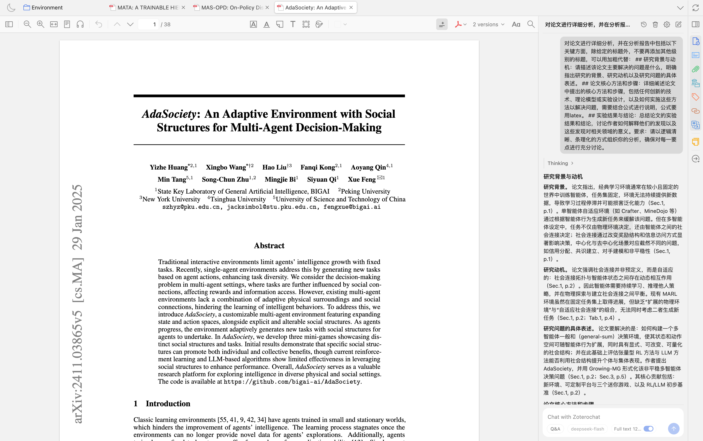

  

<h1 align="center">ZoteroChat</h1>

在 Zotero 的 PDF 阅读器里，直接和论文对话。

  
  
  

## ✨ 功能

- 📄 **引用全文**：对话支持选择是否携带当前 PDF 全文。
- 🖍 **引用标注**：在 PDF 中选中文本后自动带入当前问题。
- 💬 **预定义提示词**：设置页支持预定义提示词，如总结全文等。

## 📦 安装

1. 从 [Releases](https://github.com/Tsai-ky/zoterochat/releases) 下载最新的 `zoterochat.xpi`。
2. 在 Zotero 中打开 **工具 → 插件**，点右上角齿轮 → **Install Add-on From File…**，
   选择下载的 XPI。
3. 重启 Zotero。

## 🚀 使用

1. 在 Zotero 中打开一篇带 PDF 的文献。
2. 点阅读器工具栏的聊天按钮，或右键菜单 →「就这篇论文提问」。
3. 在右侧面板输入问题：Enter 发送，Shift+Enter 换行，Esc 停止生成。

选中 PDF 文本后会自动带入当前问题。面板顶部的对话列表可新建、切换、删除或清空对话。

## 🙏 致谢

感谢以下项目：

- 中科大词元计划
- [Zotero make-it-red](https://github.com/zotero/make-it-red)
- [zotero-plugin-template](https://github.com/windingwind/zotero-plugin-template)
- [zotero-types](https://github.com/windingwind/zotero-types)
- [zotero-plugin-dev](https://github.com/zotero-plugin-dev)

## 📄 许可

Copyright (C) 2026 Tsai-ky

本项目以 **GNU Affero General Public License v3.0 或更高版本**（AGPL-3.0-or-later）
发布，完整文本见 [LICENSE](LICENSE)。如果你修改本项目并以网络服务的形式提供给用户，
需要按 AGPL 向这些用户提供对应源码。

插件打包的第三方库（KaTeX、marked、DOMPurify）的许可证与版权声明见
[THIRD-PARTY-NOTICES.md](THIRD-PARTY-NOTICES.md)。

## 💬 反馈

使用问题或功能建议请提交到 [Issues](https://github.com/Tsai-ky/zoterochat/issues)。
